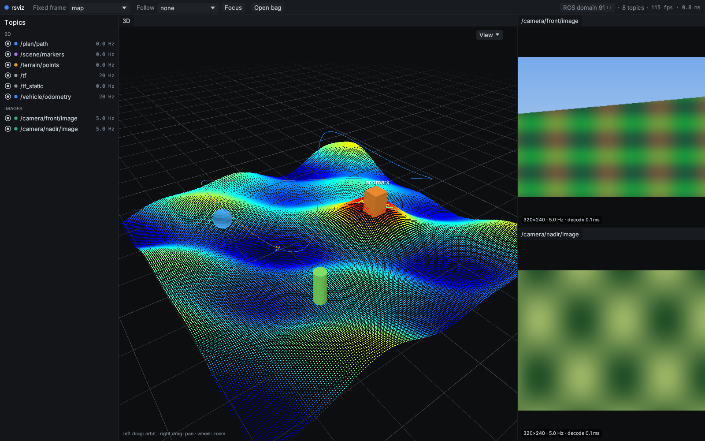

# rsviz

A small, efficient ROS 2 viewer written in Rust.



*rsviz on a synthetic scene: a point cloud, a path, markers, TF frames and two camera streams.*

rsviz shows a 3D view (point clouds, paths, odometry and pose trails, markers, robot model, TF frames, grid) and
camera panels, next to each other as draggable tiles. It is a native ROS 2 node (rcl, through
[r2r](https://github.com/sequenceplanner/r2r)): no bridge, no web server, one 26 MB binary. It runs natively on ROS 2 Jazzy, or from a docker image on any Linux. It also opens ROS 1 and
ROS 2 bags by itself, with a timeline.

## Features

- **Live topics, found by themselves.** Every second rsviz looks for topics of the types it draws and subscribes to
  them with the reliability and durability of their publishers: a best-effort camera stays best effort, a latched
  `/tf_static` or `/robot_description` is read as latched.
- **Raw messages.** Topics are subscribed as serialized CDR and decoded in place; point clouds go to the GPU as they
  are and images are decoded on one thread per topic, latest message only.
- **Bags without ROS.** ROS 1 (`.bag`), ROS 2 MCAP (`.mcap`), ROS 2 SQLite (`.db3`) or a rosbag2 directory, with
  play / pause, speed, loop and seek. A seek rebuilds the scene as it was at that time.
- **Light when idle.** With `--on-demand` it draws only when a message arrives or when you interact.
- **Any ROS domain.** `--domain N`, or the field in the top bar while it runs.

Messages drawn:

| Type | Shown as |
|---|---|
| `sensor_msgs/PointCloud2` | points in the 3D view |
| `sensor_msgs/Image`, `sensor_msgs/CompressedImage` | one camera tile per topic |
| `nav_msgs/Path` | line |
| `nav_msgs/Odometry`, `geometry_msgs/PoseStamped`, `geometry_msgs/PoseWithCovarianceStamped` | pose and its trail |
| `geometry_msgs/PointStamped` | point |
| `visualization_msgs/Marker`, `visualization_msgs/MarkerArray` | lines, arrows, shapes, textured triangle lists, texts |
| `std_msgs/String` on a `robot_description` topic | URDF robot model |
| `/tf`, `/tf_static` | frames, and the transform of everything else into the fixed frame |

## Run it with docker (any Linux)

Nothing to install but docker: no ROS and no Rust on the machine, whatever its distribution.

```bash
git clone https://github.com/jmimassi/rsviz.git && cd rsviz
./rsviz-docker.sh                                     # builds the image the first time (a few minutes), then opens rsviz
./rsviz-docker.sh --domain 37 --fixed-frame map       # the arguments of rsviz
./rsviz-docker.sh ~/bags/flight.mcap                  # a bag of the home folder (mounted read only)
```

The container shares the network and the IPC of the host: it sees the ROS 2 topics of the machine, and those of
containers started with `--network host --ipc host`. It draws with the NVIDIA GPU when docker has the NVIDIA runtime,
else with Mesa: the GPU of `/dev/dri` (Intel, AMD), or the CPU when there is none. The window goes to the X11 display
(`DISPLAY`).

## Build it natively

You need Linux with ROS 2 Jazzy (Ubuntu 24.04), a Rust toolchain and clang (r2r generates its message bindings with
bindgen). The ROS installation must provide the message packages listed in [`.cargo/config.toml`](.cargo/config.toml)
(`ros-jazzy-desktop` has them all).

```bash
sudo apt install clang libclang-dev
curl --proto '=https' --tlsv1.2 -sSf https://sh.rustup.rs | sh     # if cargo is not installed yet

git clone https://github.com/jmimassi/rsviz.git && cd rsviz
source /opt/ros/jazzy/setup.bash
cargo build --release                                               # target/release/rsviz
```

The binary needs the ROS 2 environment at run time as well (`source /opt/ros/jazzy/setup.bash`).

## Use

The same arguments with `./rsviz-docker.sh` in place of `target/release/rsviz`.

```bash
source /opt/ros/jazzy/setup.bash

target/release/rsviz                                  # the live topics of ROS_DOMAIN_ID
target/release/rsviz --domain 37 --fixed-frame map    # another ROS domain, another fixed frame
target/release/rsviz flight.mcap                      # play a bag (also: Open bag, or drop it on the window)
target/release/rsviz run.bag --rate 2 --start 30 --loop
target/release/rsviz flight.mcap --bag-info           # no window: the topics of the bag, and whether they decode
```

While a bag is open the live topics are muted; closing it brings them back.

| Option | Meaning |
|---|---|
| `--fixed-frame map` | the frame everything is drawn in |
| `--follow base_link\|none` | the TF frame the camera orbits (default: `base_link` as soon as it exists) |
| `--distance 30`, `--pitch 0.6` | start distance and pitch of the camera |
| `--topics /a,/b` | show only these topics |
| `--point-size 2`, `--trail 20000` | size of the points, length of the pose trails |
| `--domain N` | ROS domain to listen on (default: `ROS_DOMAIN_ID`) |
| `--rate 1.0`, `--start 0`, `--loop`, `--paused` | bag playback: speed, start time (s), loop, start paused |
| `--on-demand` | draw only when something changes |
| `--max-fps N`, `--present fifo\|mailbox\|immediate` | frame rate limit and presentation mode |
| `--gpu intel\|nvidia` | the GPU to draw with, by part of its name (default: the most powerful one) |
| `--width 1600 --height 1000`, `--fullscreen` | window size, or full screen (F11 toggles it) |

Controls:

| Where | Input | Action |
|---|---|---|
| 3D view | left drag / right drag / wheel | orbit / pan / zoom |
| Timeline | left click or drag | move the cursor |
| Timeline | right drag, horizontal wheel | pan |
| Timeline | Ctrl + wheel, pinch | zoom around the pointer |
| Timeline | double click | whole bag |
| Keyboard | Space | play / pause |
| Keyboard | Left / Right (with Shift) | step 0.1 s (1 s) |
| Keyboard | Home / End | start / end of the bag |
| Keyboard | F11 | full screen |

Environment:

| Variable | Meaning |
|---|---|
| `RSVIZ_MESH_PATH=dir1:dir2` | where to look, by file name, for robot meshes whose path does not exist on this machine (a model published from a container) |
| `WGPU_BACKEND=vulkan\|gl` | graphics backend (default: Vulkan) |
| `RSVIZ_MEMORY=fast` | large GPU allocation blocks (more memory, the default keeps them small) |

## License

[MIT](LICENSE). The bundled font, Inter, is under the SIL Open Font License ([assets/Inter-OFL.txt](assets/Inter-OFL.txt)).
